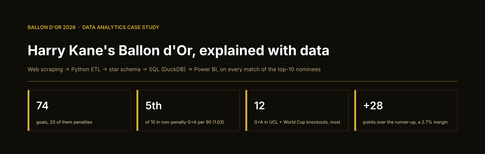
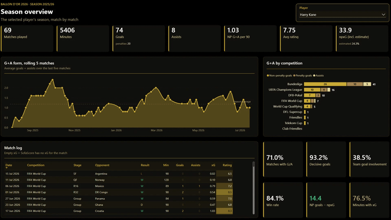
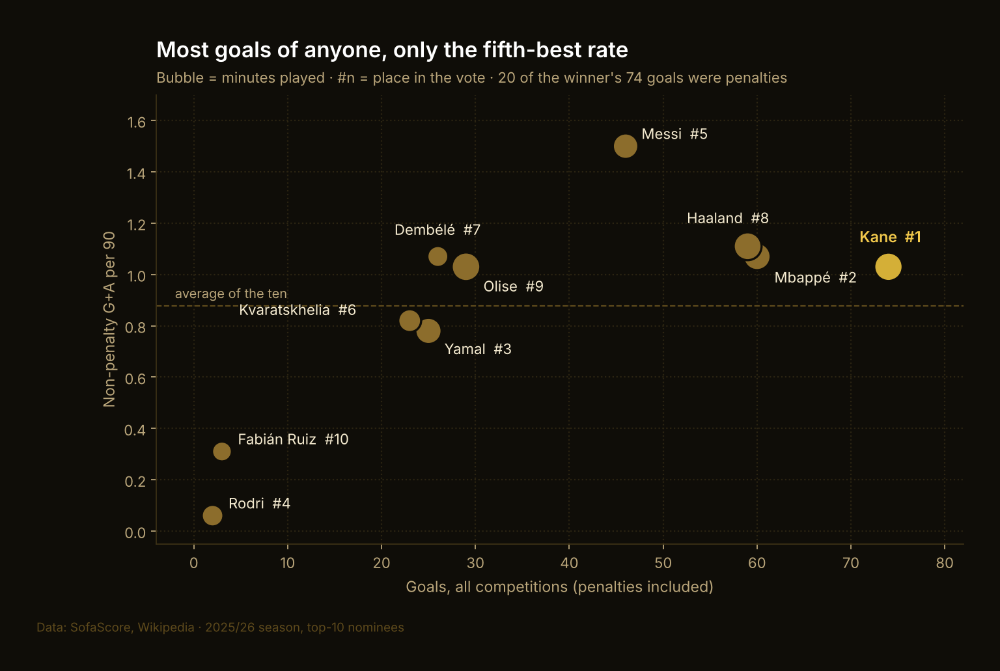
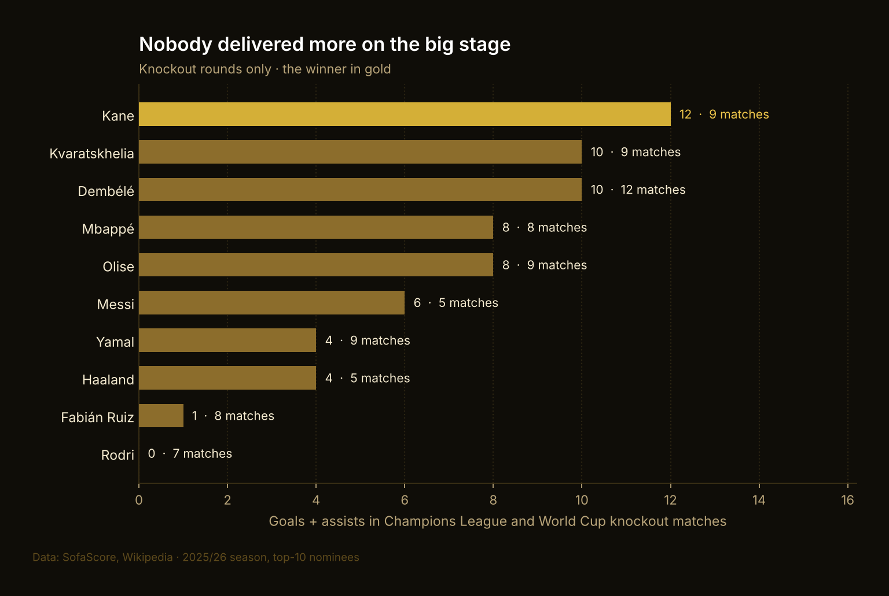
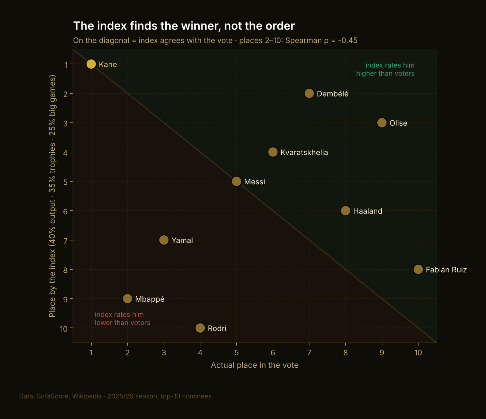
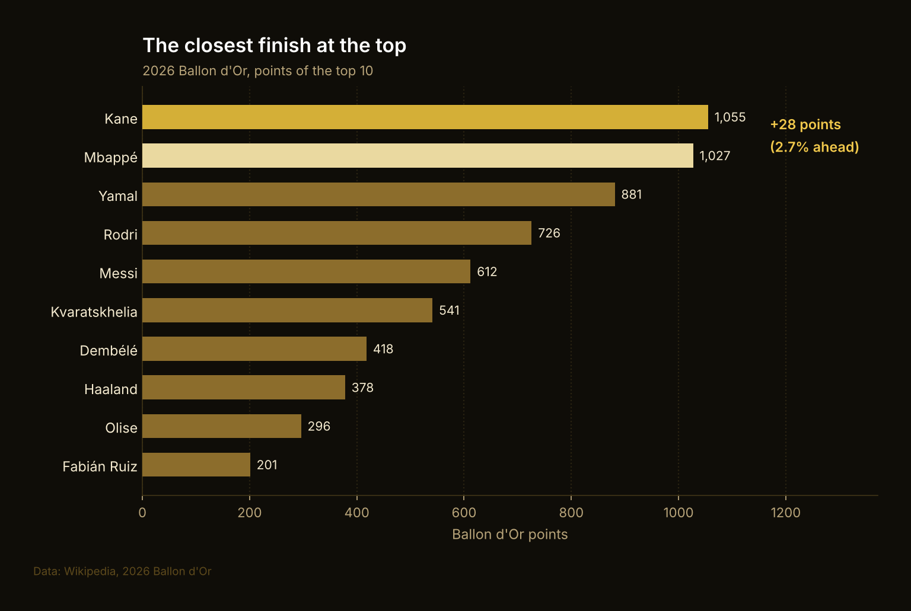
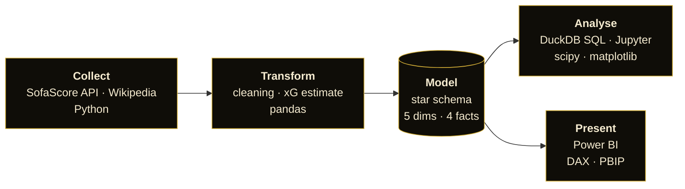

  

  
  
  
  

  <b>Did the 2026 Ballon d'Or go to the best season?</b> 
  Every match of the ten finalists scraped, modelled, analysed in SQL and Python, presented in Power BI.

  <a href="#-dashboard">Dashboard</a> ·
  <a href="#-key-findings">Findings</a> ·
  <a href="notebooks/ballon_dor_2026_analysis.ipynb">Notebook</a> ·
  <a href="sql/analysis">SQL</a> ·
  <a href="powerbi">Power BI project</a>

## 📊 Dashboard

  

Six pages: **Season overview · Nominee comparison · Big stage and knockouts · Trophies · Shortlist profile · Index vs vote** on a star-schema model with 93 DAX measures, saved as a Power BI Project (PBIP), so the whole report is version-controlled.

## 🔍 Key findings

<table>
<tr>
<td width="44%" valign="top">

### Volume won, not efficiency
**74 goals**, 14 more than anyone, but **20 were penalties**. Without penalties, per 90 minutes, Kane was only **5th of 10**.

</td>
<td></td>
</tr>
<tr>
<td valign="top">

### He delivered on the big stage
**12 goals and assists** in Champions League and World Cup knockouts (the most of the ten) and **+14.4 goals above xG**.

</td>
<td></td>
</tr>
<tr>
<td valign="top">

### Stats find the winner, not the order
An output + trophies + big-games index ranks Kane 1st, but places 2-10 run against the vote (**ρ = −0.45**). Out of 231 weightings, none fits the top 10 well. Trophies don't explain it either: the most decorated finalist came **10th**.

</td>
<td></td>
</tr>
<tr>
<td valign="top">

### It was REALLY close
**1,055 to 1,027** - a 28-point (**2.7%**) win over Mbappé.

</td>
<td></td>
</tr>
</table>

The full analysis: data checks, every query, statistics, limitations - is in **[the notebook](notebooks/ballon_dor_2026_analysis.ipynb)**.

## 🧱 How it works

- **575 player-matches** across 24 competitions, August 2025 - July 2026, from friendlies to the World Cup final.
- Where SofaScore has no xG (about 20% of minutes), comparisons use the covered matches only and season totals add a labelled shot-based estimate.
- Model and definitions: [data model](docs/data_model.md) · [methodology](docs/methodology.md).

## 📁 Repository

| folder | description |
|---|---|
| [`notebooks/`](notebooks) | the analysis |
| [`sql/`](sql) | DuckDB views and 7 analysis queries |
| [`powerbi/`](powerbi) | the Power BI project: report + semantic model |
| [`etl/`](etl) | scrapers and transformations |
| [`analysis/`](analysis) | DuckDB loader and chart code |
| [`data/`](data) | the processed star schema (`processed/`) and hand-checked inputs (`manual/`) |

---

**Elena** · data analyst · [GitHub](https://github.com/scheremetlenaa) · Data: SofaScore, Wikipedia. Not affiliated with France Football or the Ballon d'Or.
