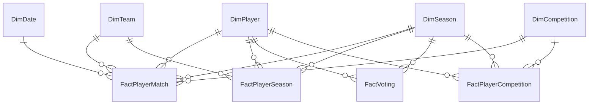

# Data model

Star schema: five dimensions, four facts and a disconnected weights table. Relationships run one way, dimension → fact; `FactPlayerMatch[OpponentTeamID]` → `DimTeam` is inactive.

| Table | Grain | Columns |
|---|---|---|
| `DimPlayer` | one player | PlayerID, PlayerName, Nationality, Position, PositionGroup, BirthDate, SofascoreID |
| `DimTeam` | one team | TeamID, TeamName, TeamType, League |
| `DimCompetition` | one competition | CompetitionID, CompetitionName, CompetitionType, IsBigStage |
| `DimSeason` | one award year | SeasonID, BallonDorYear, StartDate, EndDate, VotersCount, MaxPointsPerBallot |
| `FactPlayerMatch` | player × match | MatchID, Date, SeasonID, PlayerID, TeamID, OpponentTeamID, CompetitionID, Stage, IsKnockout, IsVsTop6, Minutes, Goals, PenaltyGoals, Assists, xG, npxG, xA, Shots, ShotsOnTarget, DecisiveGoals, Rating, TeamGoals, Result, xGIncEst, npxGIncEst, IsXgEstimated |
| `FactPlayerSeason` | player × award year | SeasonID, PlayerID, TeamID, Matches, Minutes, Goals, PenaltyGoals, Assists, xG, npxG, xA, BigStageKnockoutGA, LeaguePosition, MinutesWithXg, xGIncEst, npxGIncEst |
| `FactVoting` | player × ceremony | SeasonID, PlayerID, Rank, Points, VoteSharePct, FirstPlaceVotes |
| `FactPlayerCompetition` | player × competition × award year | SeasonID, PlayerID, TeamID, CompetitionID, StageReached, StageOrder, MaxStageOrder, IsWinner, TrophyTier, TrophyWeight |
| `IndexWeights` | one index component (disconnected) | Component, Weight |
